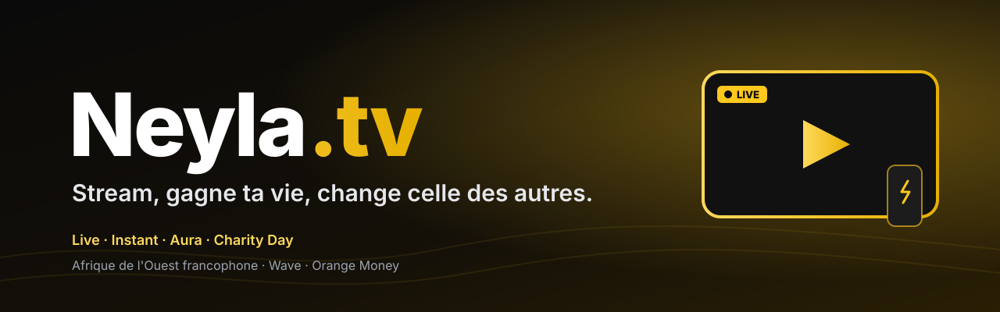

<div align="center">



**La plateforme de streaming des créateurs d'Afrique de l'Ouest francophone.**

Lives et vidéos courtes « Instant », soutien en **Aura** (tips, abonnements), retraits
**Wave / Orange Money**, et un **Charity Day** mensuel 100 % transparent.

[](https://github.com/ZurumiCEX/neyla-tv/actions/workflows/ci.yml)
[](LICENSE)
[](ROADMAP.md)
[](docs/adr/)


[Roadmap](ROADMAP.md) · [API](docs/api.md) · [Modules](docs/modules.md) · [ADR](docs/adr/) · [Déploiement](docs/runbooks/deploy-app-platform.md) · [Bunny Stream](docs/runbooks/bunny-stream-setup.md)

</div>

---

## ✨ Fonctionnalités

| | |
|---|---|
| 📡 **Live** | Clé RTMP par chaîne, lecture HLS (**Bunny Stream**), statut live/hors ligne synchronisé automatiquement, mode FAKE hors-ligne pour le dev. |
| ⚡ **Instant** | Vidéos verticales ≤ 60 s publiées par les streamers (upload direct vers Bunny), fil tendance ouvert à tous les créateurs, likes, partage. |
| 💬 **Chat** | WebSocket temps réel, slow-mode, modération (`/ban`, `/timeout`, shadow ban), anti-bot. |
| 🧭 **Découverte** | Accueil avec lives en vedette, *Parcourir* par macro-catégories (Jeux, IRL, Discussions, Musique, Créativité), recherche, Suivis. |
| 💛 **Aura** | Monnaie virtuelle : tips (70 % créateur), abonnements au prix verrouillé, abonnements offerts, retraits Wave / Orange Money avec code e-mail. |
| ❤️ **Charity Day** | Événement caritatif mensuel : dons en Aura, classement des donateurs, montants reversés publiés. |
| 🎛️ **Studio streamer** | Dashboard (audience, revenus, communauté), test de connexion, réglages OBS conseillés, widgets OBS (alertes, chat, objectif). |
| 🔐 **Comptes** | JWT (refresh en cookie HttpOnly), 2FA, inscription 18+ avec jauge de mot de passe, réinitialisation par e-mail, Turnstile anti-robots. |
| 🌍 **Accessibilité** | FR / EN / PT, thème clair et sombre (préférence système), pages légales complètes. |
| 🛡️ **Opérations** | Console admin, journal d'audit, annonces, mode maintenance, page de statut, contrôle de cohérence des portefeuilles. |

## 🏗️ Architecture

```
                 ┌──────────── DigitalOcean App Platform (ou Droplet) ───────────┐
Navigateur ─HTTP─▶│  web (Next.js 15)   ──/──                                     │
           ─HTTP─▶│  api (Django/DRF)   ──/api──        ┌── Postgres 16 (durable) │
           ─WSS──▶│  api (Channels)     ──/ws──   ◀────▶│── Redis 7 (chat, layer, │
                  │  worker · beat (Celery)             │              Celery)    │
                  └──────────────────────────────────────────────────────────────┘
OBS ──RTMP──▶ Bunny Stream ──HLS (CDN)──▶ Navigateur
Celery beat ──polling état live──▶ Bunny        Bunny ──webhook signé──▶ api (vidéos Instant)
Paiements : Stripe (carte) · Wave · Orange Money
```

Choix structurants : [ADR 001 — stack](docs/adr/001-stack-mvp.md) ·
[ADR 010 — Bunny Stream](docs/adr/010-bunny-stream.md). Détail des modules :
[`docs/modules.md`](docs/modules.md).

## 🚀 Démarrage rapide (local)

**Prérequis** : Docker + Docker Compose v2, `make`, Git.

```bash
cp .env.example .env
make up          # build + démarre tous les services
make migrate     # applique les migrations
docker compose -f infra/compose/docker-compose.yml exec api python manage.py seed_demo --flush
```

| Service   | URL                                |
|-----------|------------------------------------|
| Frontend  | http://localhost:3000              |
| API       | http://localhost:8000/api/healthz  |
| Admin     | http://localhost:8000/admin/       |

### 🧪 Données de démonstration

`seed_demo` crée une plateforme complète pour tester le MVP, sans réseau ni vraie
clé (Bunny et paiements en mode simulé) :

- 20 streamers en direct répartis sur les 5 macro-catégories (bio, réseaux
  sociaux, tags de langue, objectifs de chaîne en cours), 40 spectateurs ;
- chat animé (25 à 40 messages par live, abonnés et modérateurs), follows
  (3 à 8 chaînes par spectateur, quelques « stars »), tips avec message ;
- 50 vidéos Instant, abonnements (dont offerts et renouvelés) ;
- `viewer36` → `viewer40` : un spectateur par palier Aura (42 · 180 · 1 450 ·
  6 200 · 12 500 Aura) pour voir chaque badge ;
- un retrait Wave en cours, un achat en attente, un Charity Day avec dons et
  premier versement, des annonces et des événements au calendrier.

**Connexion** : `<compte>@demo.neyla.tv` / `DemoPass2026!` (par exemple
`admin@`, `streamer1@`, `viewer1@`).

```bash
python manage.py seed_demo --flush                 # repart de zéro
python manage.py seed_demo --streamers 30 --live-ratio 0.7
python manage.py reconcile_wallets                 # soldes == grand livre
python manage.py verify_bunny_stream               # teste la config Bunny
```

## ⚙️ Configuration essentielle

Toutes les variables sont documentées dans [`.env.example`](.env.example).

| Variable | Rôle |
|----------|------|
| `BUNNY_STREAM_LIBRARY_ID`, `BUNNY_STREAM_API_KEY`, `BUNNY_STREAM_CDN_HOSTNAME`, `BUNNY_STREAM_WEBHOOK_KEY` | Vidéo (live + Instant). Clé vide = mode FAKE. [Guide](docs/runbooks/bunny-stream-setup.md) |
| `PAYMENTS_ALLOW_FAKE` | `1` = paiements simulés autorisés (dev / démo). **`0` en production réelle.** |
| `STRIPE_SECRET_KEY`, `STRIPE_WEBHOOK_SECRET`, `WAVE_API_KEY`, `ORANGE_MONEY_API_KEY` | Encaissements réels. |
| `WITHDRAWAL_PROCESSING_FEE_PCT`, `WITHDRAWAL_MIN_AURA`, `TIP_MIN_AURA` | Frais et seuils (3 %, 1 000 Aura, 10 Aura par défaut). |
| `TURNSTILE_SITE_KEY`, `TURNSTILE_SECRET_KEY` | Anti-robots à l'inscription. |
| `NEXT_PUBLIC_API_URL`, `API_URL_INTERNAL` | URL de l'API vue par le navigateur / par le SSR. |
| `NEXT_PUBLIC_SOCIAL_*`, `NEXT_PUBLIC_CONTACT_*` | Réseaux sociaux et adresses du pied de page. |

**Modèle économique** : 30 % sur tips et abonnements (part du créateur), 1 % sur
les achats d'Aura des streamers, frais de traitement au retrait. Seule l'Aura
**gagnée** est retirable. Détails dans [`docs/api.md`](docs/api.md#monétisation-aura--apipayments).

## 🧰 Commandes utiles

| Commande        | Effet                                          |
|-----------------|------------------------------------------------|
| `make up` / `make down` | Démarre / arrête tous les services     |
| `make logs`     | Logs en suivi                                  |
| `make migrate`  | Applique les migrations                        |
| `make shell`    | Shell Django dans le conteneur API             |
| `make test`     | pytest (API) + tests web                       |
| `make lint`     | Ruff + Black --check + ESLint                  |
| `make format`   | Auto-fix (Ruff, Black, isort, Prettier)        |

## 📁 Structure

```
apps/
  api/   # Django 5 — accounts · channels_app (Bunny) · chat · catalog · social
         #            payments (Aura) · subscriptions · shorts · charity · streamers
         #            notifications · moderation · safety · analytics · ops …
  web/   # Next.js 15 — App Router, Tailwind, i18n FR/EN/PT
infra/   # Dockerfiles, docker-compose (dev / Droplet), nginx, sauvegardes
docs/    # ADR (001 → 010), runbooks, api.md, modules.md
.do/     # Spec DigitalOcean App Platform
```

## ☁️ Déploiement

**Option A — DigitalOcean App Platform (recommandé, toute la stack).**
[`.do/app.yaml`](.do/app.yaml) décrit l'API, le front, les workers Celery, le job
de migration, Postgres et Redis managés : `doctl apps create --spec .do/app.yaml`.
Guide : [`deploy-app-platform.md`](docs/runbooks/deploy-app-platform.md).

**Option B — Droplet + Docker Compose**, derrière Cloudflare (TLS + WAF) :
[ADR 007](docs/adr/007-prod-deployment.md) · [runbook](docs/runbooks/deploy.md).

**Front seul sur Vercel** : *Root Directory* = `apps/web`, et l'API hébergée à
part (`NEXT_PUBLIC_API_URL`). Voir [`deploy-vercel.md`](docs/runbooks/deploy-vercel.md).

## 📚 Documentation

| Doc | Contenu |
|-----|---------|
| [ROADMAP.md](ROADMAP.md) | Phases livrées + vision |
| [docs/api.md](docs/api.md) | Référence API (REST, WebSocket, webhooks) |
| [docs/modules.md](docs/modules.md) | Modules backend / frontend et modèles |
| [docs/adr/](docs/adr/) | Décisions d'architecture (001 → 010) |
| [docs/runbooks/](docs/runbooks/) | Déploiement, Bunny Stream, restauration, incidents |

<details>
<summary><b>Index des ADR</b></summary>

1. [Stack MVP](docs/adr/001-stack-mvp.md)
2. [Stratégie JWT](docs/adr/002-jwt-strategy.md)
3. [Cloudflare Stream (remplacé par l'ADR 010)](docs/adr/003-cloudflare-stream.md)
4. [Statut live](docs/adr/004-live-status-strategy.md)
5. [Architecture chat](docs/adr/005-chat-architecture.md)
6. [Découverte & social](docs/adr/006-discovery-and-social.md)
7. [Déploiement Droplet](docs/adr/007-prod-deployment.md)
8. [Déploiement App Platform](docs/adr/008-app-platform.md)
9. [Réactivation du worker](docs/adr/009-worker-reenablement.md)
10. [Bunny Stream, fournisseur vidéo unique](docs/adr/010-bunny-stream.md)

</details>

## 📄 Licence

Distribué sous licence **GPL-3.0**. Voir [`LICENSE`](LICENSE).
